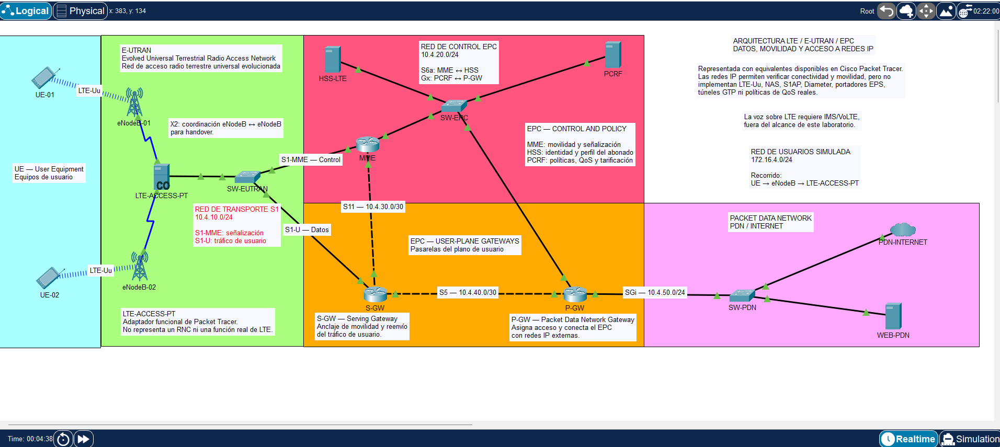

# Arquitectura móvil 4G LTE: Packet Tracer + Open5GS/srsRAN

Proyecto educativo desarrollado en dos etapas complementarias:

1. **Cisco Packet Tracer:** representación visual de E-UTRAN, EPC, interfaces, direccionamiento y recorrido del tráfico.
2. **VMware con Open5GS y srsRAN 4G:** emulación funcional de procedimientos LTE reales sin emitir radiofrecuencia.

Packet Tracer permite comprender el mapa de la red; Open5GS y srsRAN permiten observar registro del UE, RRC, S1AP, GTP-U, asignación de IP y tráfico real.



## Objetivos

- Identificar los elementos de E-UTRAN y EPC.
- Diferenciar plano de control y plano de usuario.
- Comparar una representación IP conceptual con una emulación LTE funcional.
- Validar registro, autenticación, sesión de datos, GTP-U, NAT, DNS y HTTPS.

## Etapa 1 — Modelo conceptual en Packet Tracer

| Dominio | Elementos | Función representada |
|---|---|---|
| Usuarios | UE-01, UE-02 | Terminales móviles simulados |
| E-UTRAN | eNodeB-01, eNodeB-02, LTE-ACCESS-PT, SW-EUTRAN | Acceso radio y transporte S1 conceptual |
| EPC — control | MME, HSS-LTE, PCRF | Movilidad, autenticación, abonados y políticas |
| EPC — usuario | S-GW, P-GW | Transporte y salida hacia la PDN |
| Red externa | SW-PDN, PDN-INTERNET, WEB-PDN | Servicio IP externo |

### Interfaces conceptuales

| Interfaz | Función |
|---|---|
| LTE-Uu | UE ↔ eNodeB |
| X2 | Coordinación entre eNodeB |
| S1-MME | Señalización E-UTRAN ↔ MME |
| S1-U | Tráfico E-UTRAN ↔ S-GW |
| S6a | Autenticación MME ↔ HSS |
| Gx | Políticas PCRF ↔ P-GW |
| S11 | Control MME ↔ S-GW |
| S5 | Transporte S-GW ↔ P-GW |
| SGi | Salida P-GW ↔ PDN |

### Direccionamiento conceptual

| Segmento | Red |
|---|---|
| Acceso de usuarios | `172.16.4.0/24` |
| Transporte S1 | `10.4.10.0/24` |
| Control EPC | `10.4.20.0/24` |
| S11 | `10.4.30.0/30` |
| S5 | `10.4.40.0/30` |
| SGi / PDN | `10.4.50.0/24` |

Archivo: [proyectos/05_LTE_EUTRAN_EPC.pkt](proyectos/05_LTE_EUTRAN_EPC.pkt).  
Evidencias: [pruebas-lte-packet-tracer.md](evidencias/pruebas-lte-packet-tracer.md).

Packet Tracer aproxima la arquitectura mediante encaminamiento IP. No implementa RRC, NAS, S1AP, Diameter, EPS-AKA, portadores EPS ni GTP real.

## Etapa 2 — Emulación funcional en VMware

### Versiones

| Componente | Versión |
|---|---|
| Ubuntu | 22.04.5 LTS |
| Open5GS | 2.8.0~jammy5 |
| MongoDB | 8.0.32 |
| srsRAN 4G | release_25_10 |
| Commit srsRAN | 6bcbd9e |
| ZeroMQ | 4.3.4 |

### Máquinas virtuales

| VM | Administración | Red LTE interna | Función |
|---|---|---|---|
| LTE-CORE | `192.168.100.188/24` | `192.168.110.10/24` | Open5GS EPC y MongoDB |
| LTE-RAN | `192.168.100.190/24` | `192.168.110.20/24` | srsENB, srsUE y ZeroMQ |

VMnet3 utiliza `192.168.110.0/24`; el host VMware usa `192.168.110.1`.

### Parámetros LTE

| Parámetro | Valor |
|---|---|
| MCC / MNC | 001 / 01 |
| PLMN | 00101 |
| TAC | 1 |
| APN | internet |
| Red de abonados | `10.45.0.0/16` |
| Gateway | `10.45.0.1` |
| IP observada del UE | `10.45.0.2` |
| Ancho de banda | 25 PRB |
| DL EARFCN | 3350 |

### Recorrido funcional

```text
UE 10.45.0.2
  ↕ Radio virtual ZeroMQ
srsENB 192.168.110.20
  ↕ S1-MME / SCTP 36412
  ↕ S1-U / GTP-U 2152
Open5GS 192.168.110.10
  ↕ ogstun + NAT
Internet
```

### Resultados

- eNodeB aceptado por el MME mediante SCTP.
- Celda FDD encontrada: PCI 1, 25 PRB.
- PLMN 00101 y TAC 1 reconocidos.
- Acceso aleatorio y conexión RRC completados.
- Attach exitoso e IP `10.45.0.2`.
- Ping al núcleo e Internet con 0 % de pérdida.
- DNS público y HTTPS 200.
- GTP-U bidireccional capturado en UDP/2152.
- Transición RRC IDLE → RRC CONNECTED observada.

Procedimiento: [laboratorio-open5gs-srsran.md](evidencias/laboratorio-open5gs-srsran.md).  
Scripts: [scripts/](scripts/).  
Plantillas públicas: [configuraciones/](configuraciones/).

### Evidencias visuales

| Evidencia | Validación |
|---|---|
| [Servicios Open5GS activos](evidencias/capturas/02-servicios-open5gs-activos.png) | MongoDB y componentes del EPC operativos |
| [Conexión S1 del eNodeB](evidencias/capturas/03-enodeb-s1-conectado.png) | Asociación SCTP entre eNodeB y MME |
| [Attach exitoso del UE](evidencias/capturas/04-attach-ue-exitoso.png) | RRC, registro y asignación de `10.45.0.2` |
| [Internet y DNS](evidencias/capturas/05-pruebas-internet-dns.png) | Tráfico desde `ue1` y resolución de nombres |
| [Prueba HTTPS](evidencias/capturas/06-https-200.png) | Respuesta HTTP 200 sobre TLS |
| [NAT y reenvío](evidencias/capturas/07-contadores-nat-forward.png) | `ip_forward`, MASQUERADE y FORWARD |
| [Captura GTP-U](evidencias/capturas/08-captura-gtpu-2152.png) | UDP/2152 bidireccional sin paquetes descartados |

## Comparación

| Aspecto | Packet Tracer | Open5GS + srsRAN |
|---|---|---|
| Finalidad | Visual y conceptual | Funcional y protocolar |
| Acceso radio | Cobertura simulada | Muestras I/Q por ZeroMQ |
| Registro LTE | No | Sí |
| RRC/NAS/S1AP | No | Sí |
| GTP-U | Etiqueta conceptual | Tráfico real UDP/2152 |
| IP del UE | Configurada | Asignada por el núcleo |
| Internet | Encaminamiento IP | Túnel, ogstun y NAT |

## Seguridad

No se publican BSON, respaldos de MongoDB, credenciales del WebUI ni claves privadas. Los valores de laboratorio son sintéticos y las configuraciones públicas deben estar sanitizadas.

## Estado

- [x] Modelo Packet Tracer validado.
- [x] EPC Open5GS operativo.
- [x] eNodeB y UE registrados.
- [x] GTP-U, Internet, DNS y HTTPS.
- [x] Scripts de preparación y validación.
- [x] Configuraciones públicas sanitizadas.
- [x] Capturas finales de VMware incorporadas.

## Autor

Alejandro Repupilli  
Infraestructura IT, Redes y Telecomunicaciones

## Licencia

MIT.
