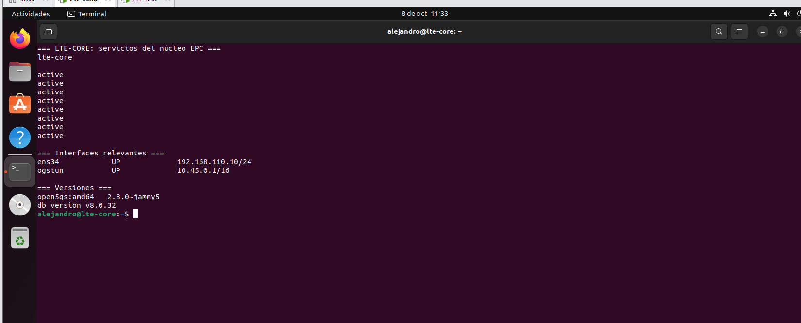
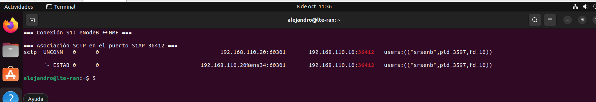
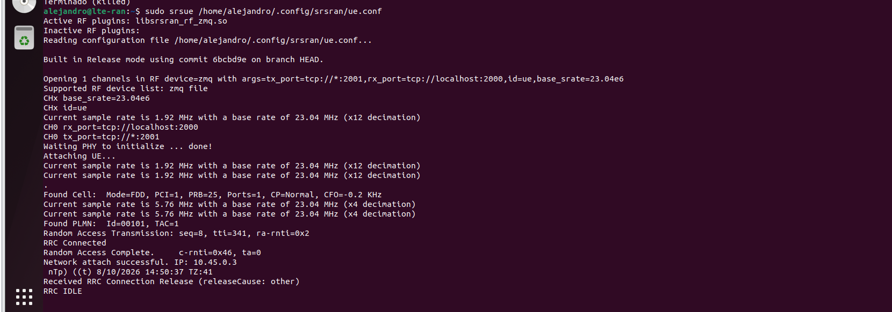
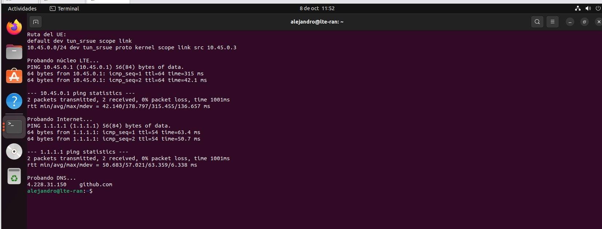
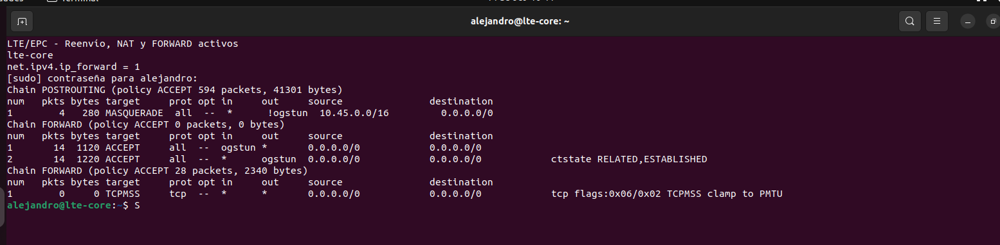
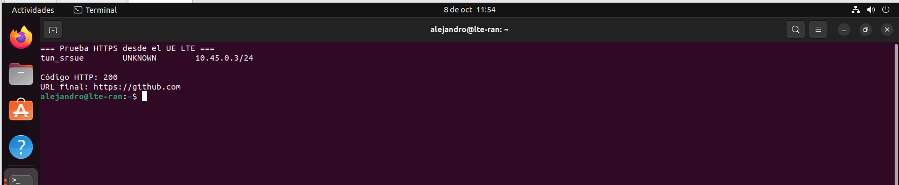
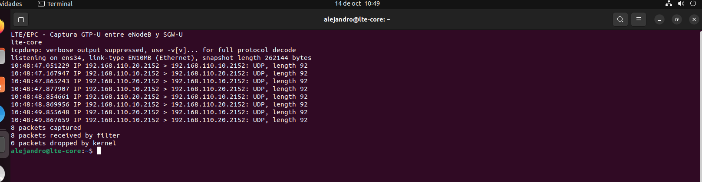

# Evidencias — Laboratorio Open5GS + srsRAN 4G

## Objetivo

Emular una red LTE funcional sin radiofrecuencia con Open5GS como EPC, srsRAN 4G como eNodeB/UE y ZeroMQ como enlace de muestras I/Q.

## Plataforma

| Elemento | Configuración |
|---|---|
| Hipervisor | VMware |
| Sistema | Ubuntu 22.04.5 LTS |
| LTE-CORE | `192.168.110.10/24` |
| LTE-RAN | `192.168.110.20/24` |
| Red del UE | `10.45.0.0/16` |

MongoDB y MME, HSS, SGW-C, SGW-U, SMF, UPF y PCRF se verificaron activos. `ogstun` quedó en `10.45.0.1/16`.



## Conexión S1

El MME aceptó al eNodeB de `192.168.110.20` mediante SCTP:

```text
[Added] Number of eNBs is now 1
192.168.110.10:36412 <-> 192.168.110.20
```



## Attach del UE

```text
Found Cell: Mode=FDD, PCI=1, PRB=25
Found PLMN: Id=00101, TAC=1
Random Access Complete
RRC Connected
Network attach successful. IP: 10.45.0.2
```

El namespace `ue1` mostró `tun_srsue` con `10.45.0.2/24`.



## Plano de usuario

Las pruebas hacia `10.45.0.1` y `1.1.1.1` obtuvieron 0 % de pérdida. Los contadores registraron MASQUERADE para `10.45.0.0/16`, reenvío desde `ogstun` y retorno RELATED,ESTABLISHED.





## DNS y HTTPS

```text
github.com -> 4.228.31.150
Código HTTP: 200
URL final: https://github.com
```



## GTP-U

```text
192.168.110.20.2152 > 192.168.110.10.2152: UDP
192.168.110.10.2152 > 192.168.110.20.2152: UDP
8 packets captured
0 packets dropped by kernel
```



## Estados RRC

Después de un período sin tráfico se observó `RRC IDLE`. Al generar tráfico, el primer paquete tuvo mayor latencia mientras el UE recuperó recursos; los siguientes se estabilizaron.

## Automatización

- `preparar-ue.sh`: crea `ue1` y configura DNS.
- `activar-internet-ue.sh`: instala la ruta y prueba núcleo, Internet y DNS.

## Conclusión

Se validaron procedimientos LTE reales, señalización S1, registro del abonado, sesión de datos, GTP-U y acceso a servicios públicos sin transmitir radiofrecuencia.
